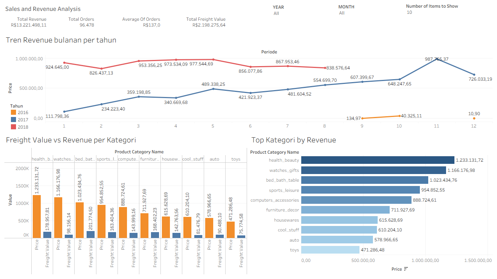

# Olist E-Commerce — Sales and Revenue Analysis

## Project Overview

This project explores sales and revenue performance using the Olist Brazilian E-Commerce dataset. I focused on three areas: monthly sales trends, revenue contribution by product category, and freight value compared to product revenue.

Through this analysis, I aim to understand how sales perform over time, which product categories generate the most revenue, and how freight value varies across categories.

## Business Objectives

This project covers three business cases to explore different aspects of Olist's sales and revenue performance.

### Business Case 1: Sales Trend Analysis

**Objective:** Understand how sales and revenue change over time by looking at monthly performance, identifying periods of growth or decline, and finding the month with the highest revenue.

### Business Case 2: Product Category Revenue Analysis

**Objective:** Find out which product categories generate the most revenue and how much each category contributes to overall sales.

### Business Case 3: Freight Value Contribution Analysis

**Objective:** Compare freight value with product revenue across categories to see which categories have a relatively high freight-to-revenue ratio.

## Dataset

This project uses the [Olist Brazilian E-Commerce Public Dataset](https://www.kaggle.com/datasets/olistbr/brazilian-ecommerce), which contains data on orders, products, customers, payments, and sellers.

**Main Tables Used:**
- `orders_dataset`
- `order_items_dataset`
- `products_dataset`
- `product_category_name_translation`

**Data Scope:**
- The analysis only includes orders with `order_status = 'delivered'`.
- Product revenue is calculated using `price`.
- `freight_value` is analyzed separately from product revenue.

## Tools & Technologies

- Python
- Pandas
- NumPy
- Matplotlib
- Seaborn
- Jupyter Notebook
- Tableau

## Analysis Workflow

1. **Import Libraries** — Import the Python libraries needed for data analysis and visualization.
2. **Data Gathering** — Load the datasets used throughout the analysis.
3. **Data Understanding** — Explore the datasets, including their structure, dimensions, column names, and data types.
4. **Data Quality Assessment & Cleaning** — Check for missing values, duplicates, and inconsistencies, then handle the identified data quality issues.
5. **Data Preparation** — Prepare the data for analysis by transforming and merging tables and creating additional columns where needed.
6. **Exploratory Data Analysis (EDA)** — Explore the data and answer the business questions through calculations and visualizations.
7. **Key Insights** — Highlight the main findings from each business case.
8. **Business Implications** — Discuss what the findings could mean for sales performance and potential areas for further evaluation.

## Key Findings

### Business Case 1: Sales Trend Analysis

- November 2017 recorded the highest monthly revenue in the analyzed period, reaching **R$987,765.37** from **7,289 orders**.
- Revenue increased by **52.37%** compared to the previous month.

### Business Case 2: Product Category Revenue Analysis

- `health_beauty` generated the highest revenue at **R$1,233,131.72**, contributing **9.33%** of total revenue.
- `watches_gifts` ranked second, generating **R$1,166,176.98** or **8.82%** of total revenue.

### Business Case 3: Freight Value Contribution Analysis

- `home_comfort_2` had the highest freight-to-revenue ratio at **53.97%**.
- `flowers` followed with a ratio of **44.04%**.

## Dashboard Preview

The dashboard brings together the main findings from this analysis, covering monthly revenue trends, product category performance, and freight value contribution.

### Interactive Dashboard

**[View the Interactive Dashboard on Tableau Public](https://public.tableau.com/app/profile/adin4572/viz/DashboardSalesandRevenueAnalysis/Dashboard1)**

### Dashboard Screenshot



## Business Implications

The findings offer a few areas worth looking into:

- **Sales Performance:** November 2017 showed a significant increase in revenue. Monitoring monthly performance can help identify similar growth patterns and periods of declining sales.
- **Product Category Performance:** `health_beauty` and `watches_gifts` were the top revenue-generating categories. Their contributions provide a starting point for evaluating which product categories play a major role in sales.
- **Freight Value:** Categories such as `home_comfort_2` and `flowers` had relatively high freight-to-revenue ratios. These categories may be worth reviewing to better understand their shipping costs relative to product revenue.

## Repository Structure

```text
Olist-Sales-Revenue/
├── README.md
├── Sales & Revenue.ipynb
└── Dashboard/
    └── Dashboard_Sales_and_Revenue_Analysis.png
```

## Conclusion

This project provides a closer look at Olist's sales and revenue performance through monthly trends, product category contributions, and freight value comparisons.

The analysis highlights how revenue changes over time, which categories contribute the most to sales, and where freight value represents a relatively large share of product revenue.

## Project Category

**Data Analysis | E-Commerce | Sales & Revenue Analysis**

**Dataset:** Olist Brazilian E-Commerce Public Dataset
